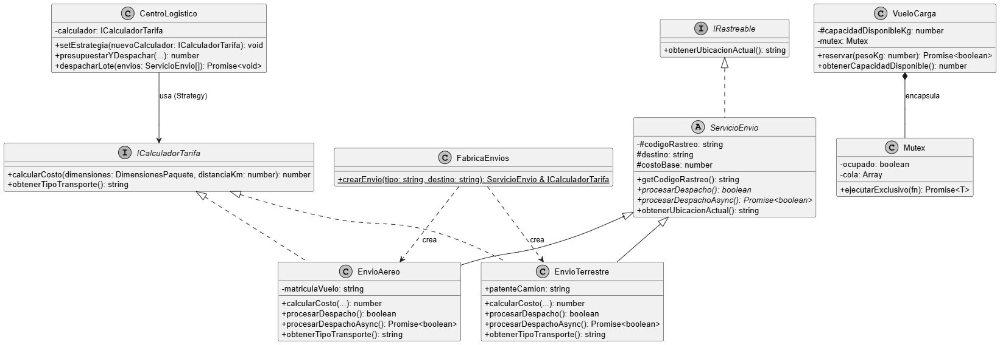

# Análisis del Paradigma Orientado a Objetos en TypeScript 

Este repositorio contiene la implementación práctica y ejecutable de los ejemplos desarrollados en el artículo técnico para la promoción de la materia Programación Orientada a Objetos.

## Estructura del Proyecto

El sistema modela una **Plataforma de Gestión de Envíos y Logística**, diseñado para mostrar los conceptos avanzados de POO que extienden la sintaxis básica. 

### Características principales:
* **Jerarquía de Clases y Abstracción:** Utilización de clases abstractas e interfaces para definir contratos claros.
* **Polimorfismo y Enlace Dinámico:** Comportamientos intercambiables en tiempo de ejecución.
* **Patrones de Diseño:** Implementación del patrón Strategy para desacoplar los algoritmos de cálculo de la lógica principal.
* **Principios SOLID:** Aplicación de los principios de SOLID, especialmente Single Responsibility y Open/Closed.

## Diagrama de Clases

